# Semantic Test Set

This table presents the 55 semantic accessibility violations of our test set ([accessguru_sampled_semantic_violations.csv](data/accessguru_dataset/accessguru_sampled_semantic_violations.csv)), with the affected HTML and a preview of the rendered page. Examples of further semantic violation types from our taxonomy are shown in [accessguru_sampled_semantic_violations_dataset.md](accessguru_sampled_semantic_violations_dataset.md).

<table border="1" >
  <tr style="text-align: right;">
      <th >#   ____</th>
      <th >Violation Type  ________________  </th>
      <th >Impact  ______</th>
      <th >Description  __________ </th>
      <th style="width: 250px; word-break: break-word; white-space: pre-wrap;">Affected HTML  _______________</th>
      <th style="width: 400px;">Preview of the Web Page with Accessibility Violation _______________________________________________________________</th>
  </tr>
<tr>
    <td>1</td>
    <td>`image-alt-not-descriptive`</td>
    <td>Critical</td>
    <td>Inaccurate or misleading alternative text that fails to describe the purpose of the image.</td>
    <td>
        <pre>&lt;html lang=&quot;en&quot;&gt;    &lt;img alt=&quot;ERCIM logo&quot; src=&quot;image.png&quot;/&gt;    &lt;/html&gt;</pre>
    </td>
    <td></td>
</tr>
<tr>
    <td>2</td>
    <td>`image-alt-not-descriptive`</td>
    <td>Critical</td>
    <td>Inaccurate or misleading alternative text that fails to describe the purpose of the image.</td>
    <td>
        <pre>&lt;html lang=&quot;en&quot;&gt;  &lt;svg aria-label=&quot;W3C&quot; role=&quot;img&quot; viewbox=&quot;0 0 512 512&quot;&gt;  &lt;path d=&quot;M108.46&quot;&gt;&lt;/path&gt;  &lt;path d=&quot;M107.6 &quot; fill=&quot;#e44d26&quot;&gt;&lt;/path&gt;  &lt;path d=&quot;M256 &quot; fill=&quot;#f16529&quot;&gt;&lt;/path&gt;  &lt;path d=&quot;M142 176&quot; fill=&quot;#ebebeb&quot;&gt;&lt;/path&gt;  &lt;path d=&quot;M369.613.6v47.2l93-25.8&quot; fill=&quot;#fff&quot;&gt;&lt;/path&gt;  &lt;/svg&gt;  &lt;/html&gt;</pre>
    </td>
    <td></td>
</tr>
<tr>
    <td>3</td>
    <td>`image-alt-not-descriptive`</td>
    <td>Critical</td>
    <td>Inaccurate or misleading alternative text that fails to describe the purpose of the image.</td>
    <td>
        <pre>&lt;!DOCTYPE html&gt;     &lt;html lang=&quot;en&quot;&gt;     &lt;head&gt;     &lt;meta charset=&quot;UTF-8&quot;&gt;     &lt;! –– Accessibility Violation starts here ––&gt;   &lt;title&gt; Canvas Image Example&lt;/title&gt;     &lt;/head&gt;     &lt;body&gt;     &lt;canvas aria-label=&quot;HTML 5 logo&quot; height=&quot;48&quot; id=&quot;logo&quot; width=&quot;72&quot;&gt;    &lt;/canvas&gt;     &lt;script&gt;     const img = new Image(); img.src = &amp;#x27;/logo.png&amp;#x27;; img.onload = function() { const ctx = document.querySelector(&amp;#x27;#logo&amp;#x27;).getContext(&amp;#x27;2d&amp;#x27;); ctx.drawImage(img, 0, 0, 72, 48); } &lt;/script&gt;     &lt;/body&gt;     &lt;/html&gt;</pre>
    </td>
    <td></td>
</tr>
<tr>
    <td>4</td>
    <td>`lang-mismatch`</td>
    <td>Serious</td>
    <td>Page language attribute does not match the actual language of the content.</td>
    <td>
        <pre>&lt;! –– Accessibility Violation starts here ––&gt;   &lt;html lang=&quot;da&quot;&gt;  &lt;head&gt;  &lt;title&gt;ACT Rules Format 1.0 - Abstract&lt;/title&gt;  &lt;/head&gt;  &lt;body&gt;  &lt;p&gt;  The Accessibility Conformance Testing (ACT) Rules Format 1.0 defines a format for writing accessibility test  rules. These test rules can be used for developing automated testing tools and manual testing methodologies. It  provides a common format that allows any party involved in accessibility testing to document and share their  testing procedures in a robust and understandable manner. This enables transparency and harmonization of testing  methods, including methods implemented by accessibility test tools.  &lt;/p&gt;  &lt;/body&gt;  &lt;/html&gt;</pre>
    </td>
    <td>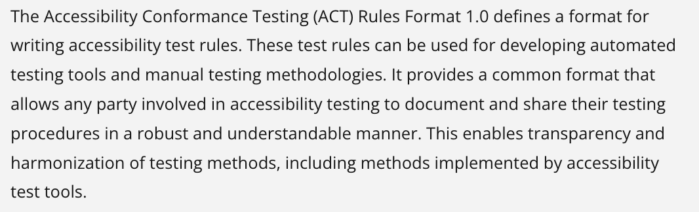</td>
</tr>
<tr>
    <td>5</td>
    <td>`lang-mismatch`</td>
    <td>Serious</td>
    <td>Page language attribute does not match the actual language of the content.</td>
    <td>
        <pre>&lt;! –– Accessibility Violation starts here ––&gt;              &lt;html lang=&quot;en&quot;&gt;  &lt;head&gt;  &lt;title&gt;Met de kippen op stok&lt;/title&gt;  &lt;/head&gt;  &lt;body&gt;  &lt;blockquote&gt;  &lt;p&gt;&quot;Hij ging met de kippen op stok&quot;&lt;/p&gt;  &lt;/blockquote&gt;  &lt;p lang=&quot;en&quot;&gt;  This Dutch phrase literally translates into &quot;  He went to roost with the chickens&quot;, but it means   that he went to bed early.  &lt;/p&gt;  &lt;/body&gt;  &lt;/html&gt;</pre>
    </td>
    <td>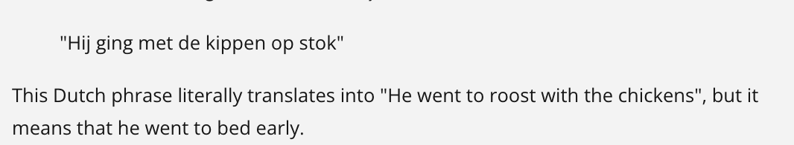</td>
</tr>
<tr>
    <td>6</td>
    <td>`lang-mismatch`</td>
    <td>Serious</td>
    <td>Page language attribute does not match the actual language of the content.</td>
    <td>
        <pre>&lt;! –– Accessibility Violation starts here ––&gt;                  &lt;html lang=&quot;nl&quot;&gt;  &lt;head&gt;  &lt;title&gt;Happy&lt;/title&gt;  &lt;/head&gt;  &lt;body&gt;    &lt;p&gt;The Dutch word    &lt;! –– Accessibility Violation starts here ––&gt;   &quot;gelukkig&quot; has no equivalent in English.&lt;/p&gt;  &lt;/body&gt;  &lt;/html&gt;</pre>
    </td>
    <td>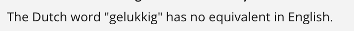</td>
</tr>
<tr>
    <td>7</td>
    <td>`lang-mismatch`</td>
    <td>Serious</td>
    <td>Page language attribute does not match the actual language of the content.</td>
    <td>
        <pre>&lt;! –– Accessibility Violation starts here ––&gt;    &lt;html lang=&quot;nl&quot;&gt;  &lt;head&gt;  &lt;title&gt;Fireworks over Paris&lt;/title&gt;  &lt;/head&gt;  &lt;body&gt;  &lt;img alt=&quot;Fireworks over Paris&quot;   src=&quot;/WAI/content-assets/wcag-act-rules/test-assets/shared/fireworks.jpg&quot;/&gt;  &lt;p lang=&quot;nl&quot;&gt;  Gelukkig nieuwjaar!  &lt;/p&gt;  &lt;/body&gt;  &lt;/html&gt;</pre>
    </td>
    <td></td>
</tr>
<tr>
    <td>8</td>
    <td>`lang-mismatch`</td>
    <td>Serious</td>
    <td>Page language attribute does not match the actual language of the content.</td>
    <td>
        <pre>&lt;! –– Accessibility Violation starts here ––&gt;   &lt;html lang=&quot;nl&quot;&gt;  &lt;head&gt;  &lt;title&gt;Paris&lt;/title&gt;  &lt;/head&gt;  &lt;body&gt;  &lt;img aria-labelledby=&quot;caption&quot; src=&quot;https://www.bvjhostelparis.com/wp-content/uploads/2017/07/PARIS-FIRE-WORKS.jpg &quot;/ &gt;    &lt;p hidden=&quot; &quot; id=&quot; caption &quot; lang= &quot; en &quot; &gt;   Fireworks over Paris!    &lt; /p &gt;    &lt; /body &gt;    &lt; /html &gt;</pre>
    </td>
    <td></td>
</tr>
<tr>
    <td>9</td>
    <td>`lang-mismatch`</td>
    <td>Serious</td>
    <td>Page language attribute does not match the actual language of the content.</td>
    <td>
        <pre>&lt;! –– Accessibility Violation starts here ––&gt;    &lt;html lang=&quot;es&quot;&gt;  &lt;head&gt;  &lt;title&gt; Stranddorp &lt;/title&gt;  &lt;/head&gt;  &lt;body&gt;  &lt;article lang=&quot;dutch&quot;&gt;  Zij liepen een vreemde Tiki bar binnen, aan de rand van een dorpje aan het strand.  &lt;/article&gt;  &lt;/body&gt;  &lt;/html&gt;</pre>
    </td>
    <td>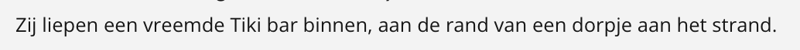</td>
</tr>
<tr>
    <td>10</td>
    <td>`lang-mismatch`</td>
    <td>Serious</td>
    <td>Page language attribute does not match the actual language of the content.</td>
    <td>
        <pre>&lt;html lang=&quot;en&quot;&gt;  &lt;body&gt;  &lt;! –– Accessibility Violation starts here ––&gt;   &lt;article lang=&quot;#!&quot;&gt;  They wandered into a strange Tiki bar on the edge of the   small beach town.  &lt;/article&gt;  &lt;/body&gt;  &lt;/html&gt;</pre>
    </td>
    <td>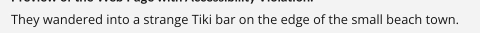</td>
</tr>
<tr>
    <td>11</td>
    <td>`lang-mismatch`</td>
    <td>Serious</td>
    <td>Page language attribute does not match the actual language of the content.</td>
    <td>
        <pre>&lt;! –– Accessibility Violation starts here ––&gt;    &lt;html lang=&quot;fr&quot;&gt;  &lt;body&gt;  &lt;! –– Accessibility Violation starts here ––&gt;    &lt;article lang=&quot;  &quot;&gt;  They wandered into a strange Tiki bar on the edge of the   small beach town.  &lt;/article&gt;  &lt;/body&gt;  &lt;/html&gt;</pre>
    </td>
    <td>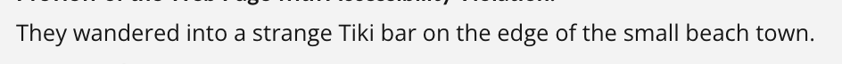</td>
</tr>
<tr>
    <td>12</td>
    <td>`lang-mismatch`</td>
    <td>Serious</td>
    <td>Page language attribute does not match the actual language of the content.</td>
    <td>
        <pre>&lt;! –– Accessibility Violation starts here ––&gt;    &lt;html lang=&quot;es&quot;&gt;  &lt;body&gt;  &lt;! –– Accessibility Violation starts here ––&gt;    &lt;article lang=&quot;english&quot;&gt;  &lt;p aria-hidden=&quot;true&quot;&gt;  They wandered into a strange Tiki bar on the edge of the   small beach town.  &lt;/p&gt;  &lt;/article&gt;  &lt;/body&gt;  &lt;/html&gt;</pre>
    </td>
    <td>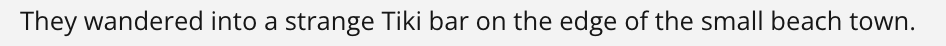</td>
</tr>
<tr>
    <td>13</td>
    <td>`lang-mismatch`</td>
    <td>Serious</td>
    <td>Page language attribute does not match the actual language of the content.</td>
    <td>
        <pre>&lt;html lang=&quot;fr&quot;&gt;  &lt;body&gt;  &lt;! –– Accessibility Violation starts here ––&gt;    &lt;article lang=&quot;English&quot;&gt;  &lt;p style=&quot;position: absolute; top: 1px&quot;&gt;  They wandered into a strange Tiki bar on the edge of the   small beach town.  &lt;/p&gt;  &lt;/article&gt;  &lt;/body&gt;  &lt;/html&gt;</pre>
    </td>
    <td></td>
</tr>
<tr>
    <td>14</td>
    <td>`lang-mismatch`</td>
    <td>Serious</td>
    <td>Page language attribute does not match the actual language of the content.</td>
    <td>
        <pre>&lt;! –– Accessibility Violation starts here ––&gt;    &lt;html lang=&quot;es&quot;&gt;  &lt;body&gt;  &lt;article lang=&quot;en&quot;&gt;  &lt;! –– Accessibility Violation starts here ––&gt;    &lt;div lang=&quot;invalid&quot;&gt;  They wandered into a strange Tiki bar on the edge of the   small beach town.  &lt;/div&gt;  &lt;/article&gt;  &lt;/body&gt;  &lt;/html&gt;</pre>
    </td>
    <td>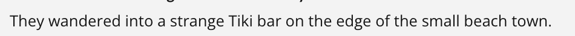</td>
</tr>
<tr>
    <td>15</td>
    <td>`lang-mismatch`</td>
    <td>Serious</td>
    <td>Page language attribute does not match the actual language of the content.</td>
    <td>
        <pre>&lt;html lang=&quot;en&quot;&gt;  &lt;body&gt;  &lt;! –– Accessibility Violation starts here ––&gt;   &lt;div lang=&quot;invalid&quot;&gt;  &lt;img alt=&quot;Fireworks over Paris&quot; src=&quot;https://PARIS-WORKS.jpg &quot; / &gt;    &lt; /div &gt;    &lt;/body&gt;    &lt;/html&gt;</pre>
    </td>
    <td></td>
</tr>
<tr>
    <td>16</td>
    <td>`lang-mismatch`</td>
    <td>Serious</td>
    <td>Page language attribute does not match the actual language of the content.</td>
    <td>
        <pre>&lt;html lang=&quot;en&quot;&gt;  &lt;body&gt;  &lt;! –– Accessibility Violation starts here ––&gt;    &lt;p lang=&quot;eng&quot;&gt;I love ACT rules! &lt;/p&gt;    &lt;/body&gt;  &lt;/html&gt;</pre>
    </td>
    <td>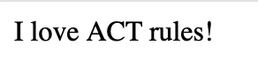</td>
</tr>
<tr>
    <td>17</td>
    <td>`lang-mismatch`</td>
    <td>Serious</td>
    <td>Page language attribute does not match the actual language of the content.</td>
    <td>
        <pre>&lt;html lang=&quot;lb&quot;&gt;  &lt;body&gt;  &lt;! –– Accessibility Violation starts here ––&gt;    &lt;p lang=&quot;i-lux&quot;&gt;  Lëtzebuerg ass e Land an Europa.  &lt;/p&gt;  &lt;/body&gt;  &lt;/html&gt;</pre>
    </td>
    <td>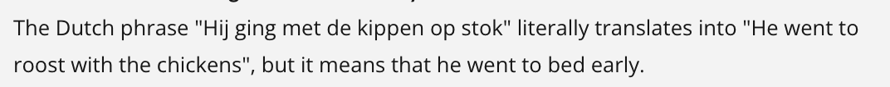</td>
</tr>
<tr>
    <td>18</td>
    <td>`missing-lang-tag`</td>
    <td>Serious</td>
    <td>Sections in different languages lack appropriate lang attributes.</td>
    <td>
        <pre>&lt;html lang=&quot;en&quot;&gt;  &lt;head&gt;  &lt;title&gt;Dutch idioms&lt;/title&gt;  &lt;/head&gt;  &lt;body&gt;  &lt;p&gt;  The Dutch phrase   &lt;! –– Accessibility Violation starts here ––&gt;    &lt;span lang=&quot;fr&quot;&gt;&quot;  Hij ging met de kippen   op stok&quot;&lt;/span&gt;    literally translates into &quot;He went to  roost with the chickens&quot;,   but it means that he went to bed early.  &lt;/p&gt;  &lt;/body&gt;  &lt;/html&gt;</pre>
    </td>
    <td>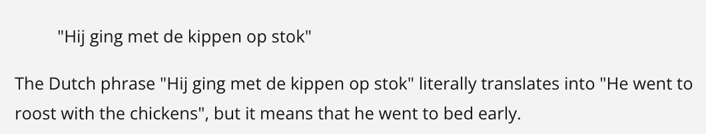</td>
</tr>
<tr>
    <td>19</td>
    <td>`missing-lang-tag`</td>
    <td>Serious</td>
    <td>Sections in different languages lack appropriate lang attributes.</td>
    <td>
        <pre>&lt;html lang=&quot;nl&quot;&gt;  &lt;head&gt;  &lt;title&gt;Met de kippen op stok&lt;/title&gt;  &lt;/head&gt;  &lt;body&gt;    &lt;! –– Accessibility Violation starts here ––&gt;    &lt;blockquote&gt;  &lt;p&gt;&quot;Hij ging met de kippen op stok&quot;&lt;/p&gt;  &lt;/blockquote&gt;  &lt;p lang=&quot;en&quot;&gt;    &lt;! –– Accessibility Violation starts here ––&gt;    &lt;span lang=&quot;fr&quot;&gt;The Dutch phrase&lt;/span&gt;        &quot;Hij ging met de kippen op stok&quot;    &lt;! –– Accessibility Violation starts here ––&gt;    &lt;span lang=&quot;fr&quot;&gt;literally translates into   &quot;He went to roost with the chickens&quot;, but it means   that he went to bed early.&lt;/span&gt;    &lt;/p&gt;  &lt;/body&gt;  &lt;/html&gt;</pre>
    </td>
    <td></td>
</tr>
<tr>
    <td>20</td>
    <td>`missing-lang-tag`</td>
    <td>Serious</td>
    <td>Sections in different languages lack appropriate lang attributes.</td>
    <td>
        <pre>&lt;html lang=&quot;fr&quot;&gt;  &lt;head&gt;  &lt;title&gt;Feu d&amp;#x27;artifice du nouvel an&lt;/title&gt;  &lt;/head&gt;  &lt;body&gt;     &lt;! –– Accessibility Violation starts here ––&gt;    &lt;div lang=&quot;fr&quot;&gt;  &lt;img alt=&quot;Fireworks over Paris&quot; src=&quot;https://www.bvjhostelparis.com/wp-content/uploads/2017/07/PARIS-FIRE-WORKS.jpg &quot; /&gt;    &lt;/div&gt;       &lt;! –– Accessibility Violation starts here ––&gt;    &lt;p lang=&quot;nl&quot;&gt;   Bonne année !  &lt;/p&gt;      &lt;/body&gt;  &lt;/html&gt;</pre>
    </td>
    <td></td>
</tr>
<tr>
    <td>21</td>
    <td>`missing-lang-tag`</td>
    <td>Serious</td>
    <td>Sections in different languages lack appropriate lang attributes.</td>
    <td>
        <pre>&lt;html lang=&quot;fr&quot;&gt;  &lt;head&gt;  &lt;title&gt;Feu d&amp;#x27;artifice du nouvel an&lt;/title&gt;  &lt;/head&gt;  &lt;body&gt;  &lt;img aria-labelledby=&quot;caption&quot; src=&quot;https://www.bvjhostelparis.com/wp-content/uploads/2017/07/PARIS-FIRE-WORKS.jpg &quot; /&gt;      &lt;! –– Accessibility Violation starts here ––&gt;    &lt;p hidden=&quot;&quot; id=&quot;caption&quot; &gt;  Fireworks over Paris  &lt;/p&gt;    &lt;/body&gt;  &lt;/html&gt;</pre>
    </td>
    <td></td>
</tr>
<tr>
    <td>22</td>
    <td>`link-text-mismatch`</td>
    <td>Serious</td>
    <td>Links fail to convey their purpose or are ambiguous.</td>
    <td>
        <pre>&lt;html lang=&quot;en&quot;&gt;  &lt;head&gt;  &lt;title&gt;Failed Example 1&lt;/title&gt;  &lt;/head&gt;  &lt;body&gt;    &lt;! –– Accessibility Violation starts here ––&gt;   &lt;a href=&quot;#desc&quot;&gt;More&lt;/a&gt;    &lt;p id=&quot;desc&quot;&gt;This product consists of several web pages.&lt;/p&gt;  &lt;/body&gt;  &lt;/html&gt;</pre>
    </td>
    <td>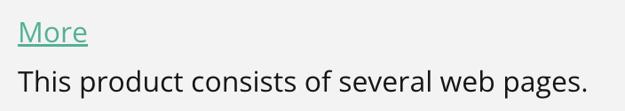</td>
</tr>
<tr>
    <td>23</td>
    <td>`link-text-mismatch`</td>
    <td>Serious</td>
    <td>Links fail to convey their purpose or are ambiguous.</td>
    <td>
        <pre>&lt;html lang=&quot;en&quot;&gt;  &lt;head&gt;  &lt;title&gt;Failed Example 2&lt;/title&gt;  &lt;/head&gt;  &lt;body&gt;    &lt;! –– Accessibility Violation starts here ––&gt;   &lt;div onclick=&quot;document.location+=&amp;#x27;#main&amp;#x27;&quot;   role=&quot;link&quot; tabindex=&quot;0&quot;&gt;More&lt;/div&gt;    &lt;main&gt;  &lt;p id=&quot;main&quot;&gt;This is the main content.&lt;/p&gt;  &lt;/main&gt;  &lt;/body&gt;  &lt;/html&gt;</pre>
    </td>
    <td>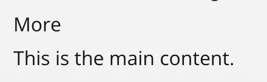</td>
</tr>
<tr>
    <td>24</td>
    <td>`link-text-mismatch`</td>
    <td>Serious</td>
    <td>Links fail to convey their purpose or are ambiguous.</td>
    <td>
        <pre>&lt;html lang=&quot;en&quot;&gt;  &lt;head&gt;  &lt;title&gt;Failed Example 3&lt;/title&gt;  &lt;/head&gt;  &lt;body&gt;  &lt;svg x=&quot;0&quot; xmlns=&quot;http://www.w3.org/2000/svg&quot; y=&quot;0&quot;&gt;    &lt;! –– Accessibility Violation starts here ––&gt;    &lt;a href=&quot;#main&quot;&gt;    &lt;text x=&quot;20&quot; y=&quot;20&quot;&gt;  Go  &lt;/text&gt;  &lt;/a&gt;  &lt;/svg&gt;  &lt;main&gt;  &lt;p id=&quot;main&quot;&gt;This is the main content.&lt;/p&gt;  &lt;/main&gt;  &lt;/body&gt;  &lt;/html&gt;</pre>
    </td>
    <td>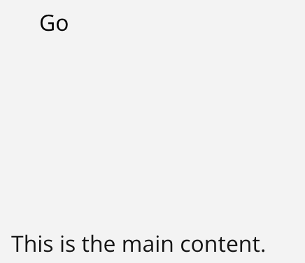</td>
</tr>
<tr>
    <td>25</td>
    <td>`link-text-mismatch`</td>
    <td>Serious</td>
    <td>Links fail to convey their purpose or are ambiguous.</td>
    <td>
        <pre>&lt;html lang=&quot;en&quot;&gt;  &lt;head&gt;  &lt;title&gt;Failed Example 4&lt;/title&gt;  &lt;/head&gt;  &lt;body&gt;  &lt;p&gt;See the description of     &lt;! –– Accessibility Violation starts here ––&gt;    &lt;a href=&quot;#desc&quot;&gt;    this product&lt;/a&gt;.&lt;/p&gt;  &lt;p id=&quot;desc&quot;&gt;This product consists of several web pages.&lt;/p&gt;  &lt;/body&gt;  &lt;/html&gt;</pre>
    </td>
    <td>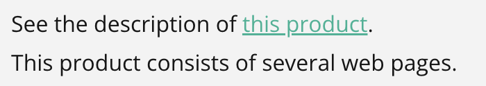</td>
</tr>
<tr>
    <td>26</td>
    <td>`link-text-mismatch`</td>
    <td>Serious</td>
    <td>Links fail to convey their purpose or are ambiguous.</td>
    <td>
        <pre>&lt;html lang=&quot;en&quot;&gt;  &lt;head&gt;  &lt;title&gt;Failed Example 5&lt;/title&gt;  &lt;/head&gt;  &lt;body&gt;  &lt;ul&gt;  &lt;li&gt;  Ulysses  &lt;ul&gt;    &lt;! –– Accessibility Violation starts here ––&gt;    &lt;li&gt;&lt;a href=&quot;https://www.gutenberg.org/files/4300/4300-h/4300-h.html &quot; &gt; HTML    &lt;/a&gt; &lt;/li&gt;        &lt;! –– Accessibility Violation starts here ––&gt;    &lt;li&gt;  &lt;a href=&quot;https://www.gutenberg.org/ebooks/4300.epub.images&quot; &gt;    EPUB    &lt;/a&gt;    &lt;/li&gt;       &lt;! –– Accessibility Violation starts here ––&gt;    &lt;li&gt;&lt;a href=&quot;https://www.gutenberg.org/files/4300/4300-0.txt&quot;&gt;   Plain text    &lt;/a&gt; &lt;/li&gt;        &lt;/ul&gt;    &lt;/li&gt;    &lt;/ul&gt;    &lt;/body&gt;  &lt;/html&gt;</pre>
    </td>
    <td>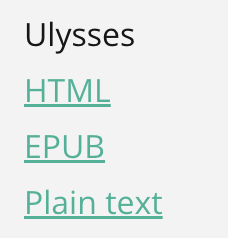</td>
</tr>
<tr>
    <td>27</td>
    <td>`link-text-mismatch`</td>
    <td>Serious</td>
    <td>Links fail to convey their purpose or are ambiguous.</td>
    <td>
        <pre>&lt;html lang=&quot;en&quot;&gt;  &lt;head&gt;  &lt;title&gt;Failed Example 1&lt;/title&gt;  &lt;/head&gt;  &lt;body&gt;    &lt;! –– Accessibility Violation starts here ––&gt;    &lt;a href=&quot;#desc&quot;&gt;More&lt;/a&gt;    &lt;p id=&quot;desc&quot;&gt;This product consists of several web pages.&lt;/p&gt;  &lt;/body&gt;  &lt;/html&gt;</pre>
    </td>
    <td>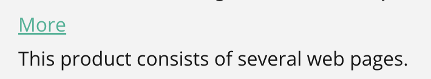</td>
</tr>
<tr>
    <td>28</td>
    <td>`link-text-mismatch`</td>
    <td>Serious</td>
    <td>Links fail to convey their purpose or are ambiguous.</td>
    <td>
        <pre>&lt;html lang=&quot;en&quot;&gt;  &lt;head&gt;  &lt;title&gt;Failed Example 2&lt;/title&gt;  &lt;/head&gt;  &lt;body&gt;    &lt;! –– Accessibility Violation starts here ––&gt;    &lt;div onclick=&quot;document.location+=&amp;#x27;#main&amp;#x27;&quot; role=&quot;link&quot; tabindex=&quot;0&quot;&gt;More  &lt;/div&gt;    &lt;main&gt;  &lt;p id=&quot;main&quot;&gt;This is the main content.&lt;/p&gt;  &lt;/main&gt;  &lt;/body&gt;  &lt;/html&gt;</pre>
    </td>
    <td>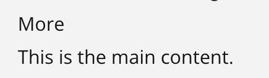</td>
</tr>
<tr>
    <td>29</td>
    <td>`link-text-mismatch`</td>
    <td>Serious</td>
    <td>Links fail to convey their purpose or are ambiguous.</td>
    <td>
        <pre>&lt;html lang=&quot;en&quot;&gt;  &lt;head&gt;  &lt;title&gt;Failed Example 3&lt;/title&gt;  &lt;/head&gt;  &lt;body&gt;  &lt;svg x=&quot;0&quot; xmlns=&quot;http://www.w3.org/2000/svg&quot; y=&quot;0&quot;&gt;    &lt;! –– Accessibility Violation starts here ––&gt;    &lt;a href=&quot;#main&quot;&gt;    &lt;text x=&quot;20&quot; y=&quot;20&quot;&gt;  Go  &lt;/text&gt;  &lt;/a&gt;  &lt;/svg&gt;  &lt;main&gt;  &lt;p id=&quot;main&quot;&gt;This is the main content.&lt;/p&gt;  &lt;/main&gt;  &lt;/body&gt;  &lt;/html&gt;</pre>
    </td>
    <td>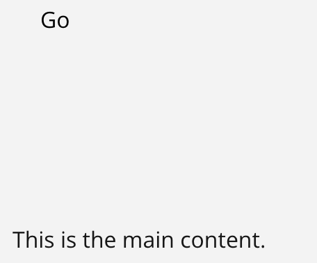</td>
</tr>
<tr>
    <td>30</td>
    <td>`link-text-mismatch`</td>
    <td>Serious</td>
    <td>Links fail to convey their purpose or are ambiguous.</td>
    <td>
        <pre>&lt;html lang=&quot;en&quot;&gt;  &lt;head&gt;  &lt;title&gt;Failed Example 4&lt;/title&gt;  &lt;/head&gt;  &lt;body&gt;  &lt;p&gt;  The W3C held a workshop on June 9-10, 2005 at DERI   Innsbruck (Austria), to gather information about potential   standardization work on Semantics in Web Services.  &lt;/p&gt;    &lt;! –– Accessibility Violation starts here ––&gt;    &lt;p&gt;&lt;a href=&quot;https://www.workshop-report.html&quot; &gt; Workshop &lt;/a&gt; &lt;/p&gt;   &lt;/body&gt;  &lt;/html&gt;</pre>
    </td>
    <td>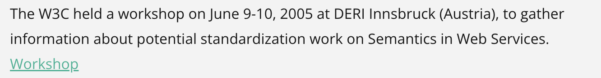</td>
</tr>
<tr>
    <td>31</td>
    <td>`link-text-mismatch`</td>
    <td>Serious</td>
    <td>Links fail to convey their purpose or are ambiguous.</td>
    <td>
        <pre>&lt;html lang=&quot;en&quot;&gt;  &lt;head&gt;  &lt;title&gt;Failed Example 5&lt;/title&gt;  &lt;/head&gt;  &lt;body&gt;  &lt;p style=&quot;font-weight: bold&quot;&gt;Ulysses&lt;/p&gt;  &lt;ul&gt;    &lt;! –– Accessibility Violation starts here ––&gt;    &lt;li&gt;&lt;a href=&quot;https://www.gutenberg.org/files/4300/4300-h/4300-h.html &quot; &gt;    HTML    &lt;/a&gt;&amp; #10; &lt;/li&gt;      &lt;! –– Accessibility Violation starts here ––&gt;    &lt;li&gt;  &lt;a href=&quot;https://www.gutenberg.org/ebooks/4300.epub.images &quot;&gt;   EPUB   &lt;/a&gt;  &lt;/li&gt;     &lt;! –– Accessibility Violation starts here ––&gt;    &lt;li&gt;&lt;a href=&quot;https://www.gutenberg.org/files/4300/4300-0.txt &quot;&gt;    Plain text    &lt;/a&gt;    &lt;/li&gt;        &lt;/ul&gt;   &lt;/body&gt;  &lt;/html&gt;</pre>
    </td>
    <td>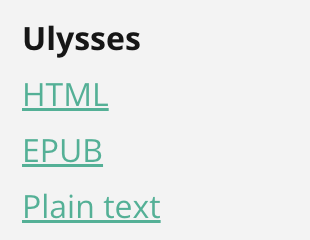</td>
</tr>
<tr>
    <td>32</td>
    <td>`link-text-mismatch`</td>
    <td>Serious</td>
    <td>Links fail to convey their purpose or are ambiguous.</td>
    <td>
        <pre>&lt;html lang=&quot;en&quot;&gt;  &lt;head&gt;  &lt;title&gt;Failed Example 6&lt;/title&gt;  &lt;/head&gt;  &lt;body&gt;  &lt;table&gt;  &lt;tr&gt;  &lt;th colspan=&quot;3&quot;&gt;Books&lt;/th&gt;  &lt;/tr&gt;  &lt;tr&gt;  &lt;td&gt;Ulysses&lt;/td&gt;      &lt;! –– Accessibility Violation starts here ––&gt;    &lt;td&gt;&lt;a href=&quot;https://www.gutenberg.org/files/4300/4300-h/4300-h.html &quot;&gt;Download &lt;/a&gt; &lt;/td&gt;    &lt;td&gt; 1.61MB &lt;/td&gt;    &lt;/tr&gt;    &lt;/table&gt;    &lt;/body&gt;   &lt;/html&gt;</pre>
    </td>
    <td>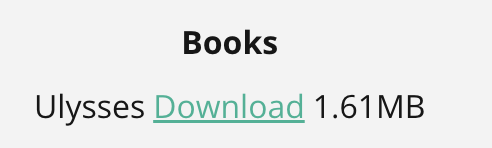</td>
</tr>
<tr>
    <td>33</td>
    <td>`form-label-mismatch`</td>
    <td>Critical</td>
    <td>Forms elements have unclear or incorrect labels.</td>
    <td>
        <pre>&lt;html lang=&quot;en&quot;&gt;  &lt;label&gt;Date    &lt;! –– Accessibility Violation starts here ––&gt;    &lt;input id=&quot;fname&quot; name=&quot;fname&quot; type=&quot;text&quot;/&gt;&lt;/label&gt;    &lt;/html&gt;</pre>
    </td>
    <td>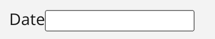</td>
</tr>
<tr>
    <td>34</td>
    <td>`form-label-mismatch`</td>
    <td>Critical</td>
    <td>Forms elements have unclear or incorrect labels.</td>
    <td>
        <pre>&lt;html lang=&quot;en&quot;&gt;  &lt;label for=&quot;fname&quot;&gt;Age&lt;/label&gt;    &lt;! –– Accessibility Violation starts here ––&gt;    &lt;input id=&quot;address&quot; name=&quot;address&quot; type=&quot;text&quot;/&gt;  &lt;/html&gt;</pre>
    </td>
    <td>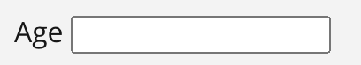</td>
</tr>
<tr>
    <td>35</td>
    <td>`form-label-mismatch`</td>
    <td>Critical</td>
    <td>Forms elements have unclear or incorrect labels.</td>
    <td>
        <pre>&lt;html lang=&quot;en&quot;&gt;  &lt;p id=&quot;label_fname&quot;&gt;What is your previous address?&lt;/p&gt;    &lt;! –– Accessibility Violation starts here ––&gt;    &lt;input aria-labelledby=&quot;add&quot; name=&quot;add&quot; type=&quot;text&quot;/&gt;  &lt;/html&gt;</pre>
    </td>
    <td>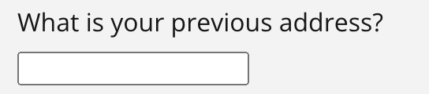</td>
</tr>
<tr>
    <td>36</td>
    <td>`form-label-mismatch`</td>
    <td>Critical</td>
    <td>Forms elements have unclear or incorrect labels.</td>
    <td>
        <pre>&lt;html lang=&quot;en&quot;&gt;  &lt;fieldset&gt;    &lt;! –– Accessibility Violation starts here ––&gt;    &lt;h2 style=&quot;position: absolute; top: -9999px; left: -9999px;&quot;&gt;Shipping address&lt;/h2&gt;  &lt;label&gt;First Name:: &lt;input name=&quot;shipping-street&quot; type=&quot;text&quot;/&gt;&lt;/label&gt;  &lt;label&gt;Last Name:: &lt;input name=&quot;shipping-street&quot; type=&quot;text&quot;/&gt;&lt;/label&gt;    &lt;/fieldset&gt;  &lt;fieldset&gt;    &lt;! –– Accessibility Violation starts here ––&gt;    &lt;h2 style=&quot;position: absolute; top: -9999px; left: -9999px;&quot;&gt;Contact Information&lt;/h2&gt;  &lt;label&gt;House Number: &lt;input name=&quot;contact-info&quot; type=&quot;text&quot;/&gt;&lt;/label&gt;  &lt;label&gt;Street: &lt;input name=&quot;contact-info&quot; type=&quot;text&quot;/&gt;&lt;/label&gt;      &lt;/fieldset&gt;  &lt;/html&gt;</pre>
    </td>
    <td>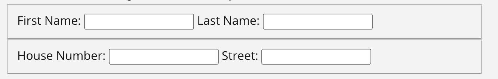</td>
</tr>
<tr>
    <td>37</td>
    <td>`form-label-mismatch`</td>
    <td>Critical</td>
    <td>Forms elements have unclear or incorrect labels.</td>
    <td>
        <pre>&lt;html lang=&quot;en&quot;&gt;  &lt;span id=&quot;search&quot; style=&quot;display: none&quot;&gt;Search&lt;/span&gt;    &lt;! –– Accessibility Violation starts here ––&gt;    &lt;input aria-labelledby=&quot;submit search by clicking here&quot; name=&quot;search&quot; type=&quot;text&quot;/&gt;  &lt;button id=&quot;submit&quot;&gt;Go&lt;/button&gt;  &lt;/html&gt;</pre>
    </td>
    <td>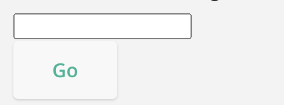</td>
</tr>
<tr>
    <td>38</td>
    <td>`ambiguous-heading`</td>
    <td>Moderate</td>
    <td>Headings are vague, repetitive, or fail to describe the content.</td>
    <td>
        <pre>&lt;html lang=&quot;en&quot;&gt;    &lt;! –– Accessibility Violation starts here ––&gt;    &lt;h1&gt;Weather&lt;/h1&gt;    &lt;p&gt;We are open Monday through Friday from 10 to 16&lt;/p&gt;  &lt;/html&gt;</pre>
    </td>
    <td></td>
</tr>
<tr>
    <td>39</td>
    <td>`ambiguous-heading`</td>
    <td>Moderate</td>
    <td>Headings are vague, repetitive, or fail to describe the content.</td>
    <td>
        <pre>&lt;html lang=&quot;en&quot;&gt;    &lt;! –– Accessibility Violation starts here ––&gt;    &lt;span aria-level=&quot;1&quot; role=&quot;heading&quot;&gt;Weather&lt;/span&gt;    &lt;p&gt;We are open Monday through Friday from 10 to 16&lt;/p&gt;  &lt;/html&gt;</pre>
    </td>
    <td>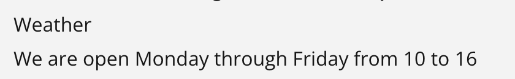</td>
</tr>
<tr>
    <td>40</td>
    <td>`ambiguous-heading`</td>
    <td>Moderate</td>
    <td>Headings are vague, repetitive, or fail to describe the content.</td>
    <td>
        <pre>&lt;html lang=&quot;en&quot;&gt;    &lt;! –– Accessibility Violation starts here ––&gt;    &lt;span aria-level=&quot;1&quot; role=&quot;heading&quot; style=&quot;position: absolute; top: -9999px; left: -9999px;&quot;&gt;  Weather  &lt;/span&gt;    &lt;p&gt;  We are open Monday through Friday from 10 to 16  &lt;/p&gt;  &lt;/html&gt;</pre>
    </td>
    <td></td>
</tr>
<tr>
    <td>41</td>
    <td>`ambiguous-heading`</td>
    <td>Moderate</td>
    <td>Headings are vague, repetitive, or fail to describe the content.</td>
    <td>
        <pre>&lt;html lang=&quot;en&quot;&gt;    &lt;! –– Accessibility Violation starts here ––&gt;    &lt;h1&gt;Weather&lt;/h1&gt;    &lt;p&gt;We are open Monday through Friday from 10 to 16&lt;/p&gt;  &lt;p&gt;It is going to rain tomorrow&lt;/p&gt;  &lt;/html&gt;</pre>
    </td>
    <td>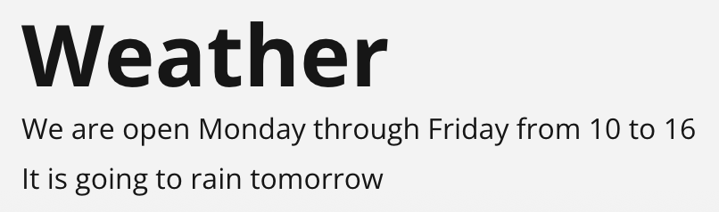</td>
</tr>
<tr>
    <td>42</td>
    <td>`page-title-not-descriptive`</td>
    <td>Serious</td>
    <td>Page title fails to describe the content or purpose of the page, making navigation difficult.</td>
    <td>
        <pre>&lt;html lang=&quot;en&quot;&gt;  &lt;head&gt;    &lt;! –– Accessibility Violation starts here ––&gt;    &lt;title&gt;Apple harvesting season&lt;/title&gt;    &lt;/head&gt;  &lt;body&gt;  &lt;p&gt;  Clementines will be ready to harvest from late October   through February.  &lt;/p&gt;  &lt;/body&gt;  &lt;/html&gt;</pre>
    </td>
    <td>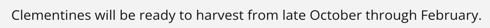</td>
</tr>
<tr>
    <td>43</td>
    <td>`page-title-not-descriptive`</td>
    <td>Serious</td>
    <td>Page title fails to describe the content or purpose of the page, making navigation difficult.</td>
    <td>
        <pre>&lt;html lang=&quot;en&quot;&gt;  &lt;head&gt;    &lt;! –– Accessibility Violation starts here ––&gt;    &lt;title&gt;Cucumber and Tomato Harvest&lt;/title&gt;  &lt;title&gt;Clementine harvesting season&lt;/title&gt;      &lt;/head&gt;  &lt;body&gt;  &lt;p&gt;  Clementines will be ready to harvest from late October   through February.  &lt;/p&gt;  &lt;/body&gt;  &lt;/html&gt;</pre>
    </td>
    <td>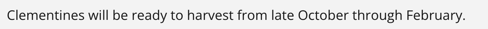</td>
</tr>
<tr>
    <td>44</td>
    <td>`page-title-not-descriptive`</td>
    <td>Serious</td>
    <td>Page title fails to describe the content or purpose of the page, making navigation difficult.</td>
    <td>
        <pre>&lt;html lang=&quot;en&quot;&gt;  &lt;head&gt;    &lt;! –– Accessibility Violation starts here ––&gt;    &lt;title&gt;University of Arkham&lt;/title&gt;    &lt;/head&gt;  &lt;body&gt;  &lt;h1&gt;Search results for &quot;accessibility&quot; at the University of Arkham&lt;/h1&gt;  &lt;p&gt;None&lt;/p&gt;  &lt;/body&gt;  &lt;/html&gt;</pre>
    </td>
    <td>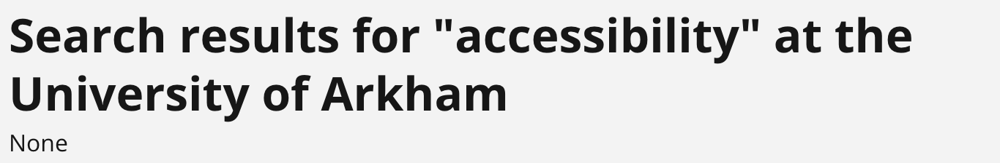</td>
</tr>
<tr>
    <td>45</td>
    <td>`button-label-mismatch`</td>
    <td>Critical</td>
    <td>Buttons labels are unclear or fail to specify their purpose.</td>
    <td>
        <pre>&lt;html lang=&quot;en&quot;&gt;  &lt;head&gt;  &lt;title&gt;Passed Example 1&lt;/title&gt;  &lt;/head&gt;  &lt;body&gt;    &lt;! –– Accessibility Violation starts here ––&gt;    &lt;input alt=&quot;Clear Form&quot; src=&quot;/WAI/content-assets/wcag-act-rules/test-assets/shared/icon.svg&quot; type=&quot;image&quot;/&gt;    &lt;/body&gt;  &lt;/html&gt;</pre>
    </td>
    <td></td>
</tr>
<tr>
    <td>46</td>
    <td>`button-label-mismatch`</td>
    <td>Critical</td>
    <td>Buttons labels are unclear or fail to specify their purpose.</td>
    <td>
        <pre>&lt;html lang=&quot;en&quot;&gt;  &lt;head&gt;  &lt;title&gt;Failed Example 2&lt;/title&gt;  &lt;/head&gt;  &lt;body&gt;    &lt;! –– Accessibility Violation starts here ––&gt;    &lt;input aria-label=&quot;Search&quot; src=&quot;/WAI/content-assets/wcag-act-rules/test-assets/shared/icon.svg&quot; type=&quot;image&quot;/&gt;      &lt;/body&gt;  &lt;/html&gt;</pre>
    </td>
    <td></td>
</tr>
<tr>
    <td>47</td>
    <td>`button-label-mismatch`</td>
    <td>Critical</td>
    <td>Buttons labels are unclear or fail to specify their purpose.</td>
    <td>
        <pre>&lt;html lang=&quot;en&quot;&gt;  &lt;head&gt;  &lt;title&gt;Failed Example 3&lt;/title&gt;  &lt;/head&gt;  &lt;body&gt;    &lt;! –– Accessibility Violation starts here ––&gt;    &lt;input src=&quot;/WAI/content-assets/wcag-act-rules/test-assets/shared/search-icon.svg&quot; title=&quot;Back&quot; type=&quot;image&quot;/&gt;      &lt;/body&gt;  &lt;/html&gt;</pre>
    </td>
    <td></td>
</tr>
<tr>
    <td>48</td>
    <td>`button-label-mismatch`</td>
    <td>Critical</td>
    <td>Buttons labels are unclear or fail to specify their purpose.</td>
    <td>
        <pre>&lt;html lang=&quot;en&quot;&gt;  &lt;head&gt;  &lt;title&gt;Failed Example 4&lt;/title&gt;  &lt;/head&gt;  &lt;body&gt;    &lt;! –– Accessibility Violation starts here ––&gt;    &lt;input aria-labelledby=&quot;id1&quot; src=&quot;/WAI/content-assets/wcag-act-rules/test-assets/shared/icon.svg&quot; type=&quot;image&quot;/&gt;  &lt;div id=&quot;id1&quot;&gt;Upload&lt;/div&gt;      &lt;/body&gt;  &lt;/html&gt;</pre>
    </td>
    <td></td>
</tr>
<tr>
    <td>49</td>
    <td>`button-label-mismatch`</td>
    <td>Critical</td>
    <td>Buttons labels are unclear or fail to specify their purpose.</td>
    <td>
        <pre>&lt;button id=&quot;voiceSearchButton&quot;   class=&quot;icon-button&quot;   title=&quot;Upload Document&quot;&gt;    &lt;img src=\&quot;https://example.com/icon.png&quot;&gt;   &lt;/button&gt;</pre>
    </td>
    <td></td>
</tr>
<tr>
    <td>50</td>
    <td>`image-alt-not-descriptive`</td>
    <td>Critical</td>
    <td>Inaccurate or misleading alternative text that fails to describe the purpose of the image.</td>
    <td>
        <pre>&lt;!DOCTYPE html&gt;  &lt;html lang=&quot;en&quot;&gt;  &lt;head&gt;      &lt;meta charset=&quot;UTF-8&quot;&gt;      &lt;meta name=&quot;viewport&quot; content=&quot;width=device-width, initial-scale=1.0&quot;&gt;      &lt;meta name=&quot;description&quot; content=&quot;A simple webpage about climate change featuring a graph image with accessibility considerations.&quot;&gt;      &lt;title&gt;Climate Change Insights&lt;/title&gt;      &lt;/head&gt;  &lt;body&gt;      &lt;header&gt;          &lt;h1&gt;Understanding Climate Change&lt;/h1&gt;          &lt;p&gt;This page highlights the impact of climate change through data visualization.&lt;/p&gt;      &lt;/header&gt;    &lt;! –– Accessibility Violation starts here ––&gt;        &lt;main&gt;          &lt;img src=&quot;graphblog-1.png &quot; alt=&quot;A pie chart showing the percentage distribution of diabetes prevalence by age group. &quot; /&gt;      &lt;/main&gt;      &lt;footer&gt;     &lt;p&gt; Data sourced from Global Climate Watch  &lt;a href= &quot;#&quot; aria-label=&quot;Learn more about climate change&quot;&gt;Learn more&lt;/a&gt;&lt;/p&gt;      &lt;/footer&gt;    &lt;/body&gt;    &lt;/html&gt;</pre>
    </td>
    <td>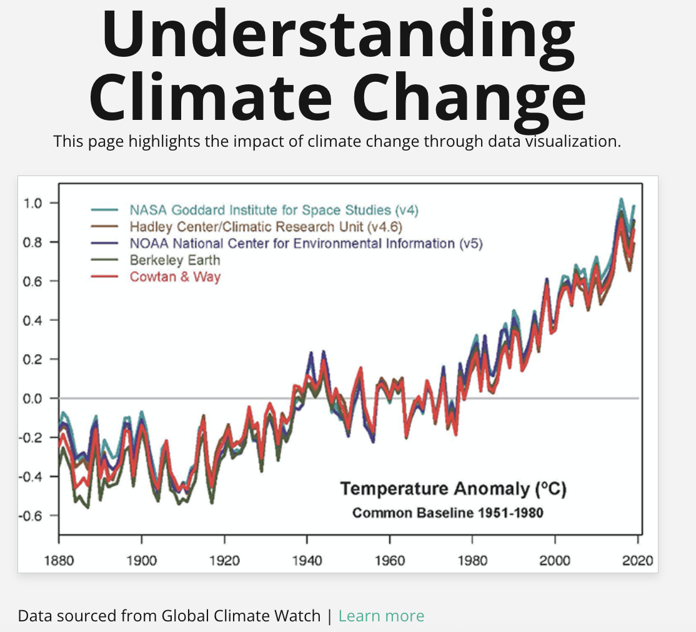</td>
</tr>
<tr>
    <td>51</td>
    <td>`image-alt-not-descriptive`</td>
    <td>Critical</td>
    <td>Inaccurate or misleading alternative text that fails to describe the purpose of the image.</td>
    <td>
        <pre>&lt;!DOCTYPE html&gt;  &lt;html lang=&quot;en&quot;&gt;  &lt;head&gt;      &lt;meta charset=&quot;UTF-8&quot;&gt;      &lt;meta name=&quot;viewport&quot; content=&quot;width=device-width, initial-scale=1.0&quot;&gt;      &lt;meta name=&quot;description&quot; content=&quot;A simple webpage discussing renewable energy sources with a focus on solar power.&quot;&gt;      &lt;title&gt;Renewable Energy Spotlight&lt;/title&gt;     &lt;/head&gt;  &lt;body&gt;      &lt;header&gt;          &lt;h1&gt;Renewable Energy Sources&lt;/h1&gt;          &lt;p&gt;Exploring the future of clean and sustainable energy&lt;/p&gt;      &lt;/header&gt;        &lt;nav&gt;          &lt;a href=&quot;#solar&quot;&gt;Solar Power&lt;/a&gt;          &lt;a href=&quot;#wind&quot;&gt;Wind Energy&lt;/a&gt;          &lt;a href=&quot;#hydro&quot;&gt;Hydropower&lt;/a&gt;      &lt;/nav&gt;        &lt;div class=&quot;container&quot;&gt;          &lt;main&gt;              &lt;h2 id=&quot;solar&quot;&gt;Solar Power&lt;/h2&gt;              &lt;p&gt;Solar energy is one of the most abundant and clean sources of renewable energy. It uses photovoltaic cells to convert sunlight directly into electricity.&lt;/p&gt;            &lt;! –– Accessibility Violation starts here ––&gt;        &lt;img src=&quot;https://images.stockcake.com/public/b/7/a/b7a38663-0207-4222-932a-d25a576f5dd7_large/solar-power-generation-stockcake.jpg&quot; alt=&quot;Wind turbines at sunset.&quot; /&gt;                    &lt;h2 id=&quot;wind&quot;&gt;Wind Energy&lt;/h2&gt;              &lt;p&gt;Wind turbines harness the kinetic energy of the wind and transform it into electricity. Wind energy is growing rapidly as a sustainable alternative to fossil fuels.&lt;/p&gt;                &lt;h2 id=&quot;hydro&quot;&gt;Hydropower&lt;/h2&gt;              &lt;p&gt;Hydropower generates electricity by capturing the energy of moving water, usually from rivers or dams. It is a reliable and proven source of renewable energy.&lt;/p&gt;          &lt;/main&gt;      &lt;/div&gt;        &lt;footer&gt;          &lt;p&gt;&amp;amp;copy; 2025 Renewable Insights  &lt;a href= &quot;#&quot; style= &quot;color: #fff;&quot; &gt;Contact Us &lt;/a&gt; &lt;/p&gt;     &lt;/footer&gt;    &lt;/body&gt;    &lt;/html&gt;</pre>
    </td>
    <td>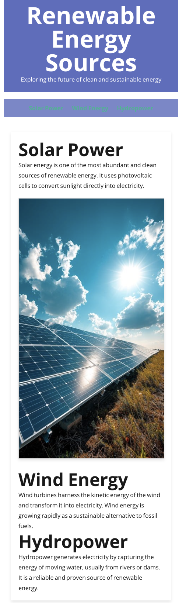</td>
</tr>
<tr>
    <td>52</td>
    <td>`image-alt-not-descriptive`</td>
    <td>Critical</td>
    <td>Inaccurate or misleading alternative text that fails to describe the purpose of the image.</td>
    <td>
        <pre>&lt;!DOCTYPE html&gt;  &lt;html lang=&quot;en&quot;&gt;  &lt;head&gt;      &lt;meta charset=&quot;UTF-8&quot;&gt;      &lt;meta name=&quot;viewport&quot; content=&quot;width=device-width, initial-scale=1.0&quot;&gt;      &lt;meta name=&quot;description&quot; content=&quot;A simple webpage promoting mental health awareness and well-being.&quot;&gt;      &lt;title&gt;Mental Health Awareness&lt;/title&gt;      &lt;/head&gt;  &lt;body&gt;      &lt;header&gt;          &lt;h1&gt;Mental Health Matters&lt;/h1&gt;          &lt;p&gt;Promoting awareness, reducing stigma, and encouraging self-care&lt;/p&gt;      &lt;/header&gt;        &lt;nav&gt;          &lt;a href=&quot;#importance&quot;&gt;Importance&lt;/a&gt;          &lt;a href=&quot;#tips&quot;&gt;Self-Care Tips&lt;/a&gt;          &lt;a href=&quot;#resources&quot;&gt;Resources&lt;/a&gt;      &lt;/nav&gt;        &lt;div class=&quot;container&quot;&gt;          &lt;main&gt;              &lt;h2 id=&quot;importance&quot;&gt;The Importance of Mental Health&lt;/h2&gt;              &lt;p&gt;Mental health is vital to overall well-being. It affects how we think, feel, and act in our daily lives. Recognizing its importance helps reduce stigma and promotes a supportive community.&lt;/p&gt;                &lt;! –– Accessibility Violation starts here ––&gt;    &lt;img src=&quot;https://thumbs.dreamstime.com/b/mental-health-infographic-diagram-chart-illustration-banner-presentation-has-managing-stress-meaning-purpose-staying-active-315756097.jpg&quot; alt=&quot;A diagram of unrelated objects and ideas, possibly showcasing the lifecycle of a butterfly, an exercise routine, or random abstract symbols.&quot; /&gt;                    &lt;h2 id=&quot;tips&quot;&gt;Self-Care Tips&lt;/h2&gt;              &lt;p&gt;Taking care of your mental health is essential. Here are a few tips:&lt;/p&gt;              &lt;ul&gt;                  &lt;li&gt;Practice mindfulness or meditation&lt;/li&gt;                  &lt;li&gt;Stay physically active&lt;/li&gt;                  &lt;li&gt;Maintain a balanced diet&lt;/li&gt;                  &lt;li&gt;Connect with loved ones&lt;/li&gt;                  &lt;li&gt;Seek professional help when needed&lt;/li&gt;              &lt;/ul&gt;                &lt;h2 id=&quot;resources&quot;&gt;Helpful Resources&lt;/h2&gt;              &lt;p&gt;If you&amp;#x27;re struggling with your mental health, don&amp;#x27;t hesitate to reach out for help. Here are some trusted resources:&lt;/p&gt;              &lt;ul&gt;                  &lt;li&gt;&lt;a href=&quot;#&quot;&gt;National Mental Health Hotline&lt;/a&gt;&lt;/li&gt;                  &lt;li&gt;&lt;a href=&quot;#&quot;&gt;Mindfulness and Meditation Apps&lt;/a&gt;&lt;/li&gt;                  &lt;li&gt;&lt;a href=&quot;#&quot;&gt;Support Groups in Your Area&lt;/a&gt;&lt;/li&gt;              &lt;/ul&gt;          &lt;/main&gt;      &lt;/div&gt;        &lt;footer&gt;          &lt;p&gt;&amp;amp;copy; 2025 Mental Health Awareness  &lt;a href= &quot;#&quot; style= &quot;color: #fff; &quot; &gt;Contact Us &lt;/a&gt; &lt;/p&gt;       &lt;/footer&gt;    &lt;/body&gt;    &lt;/html&gt;</pre>
    </td>
    <td>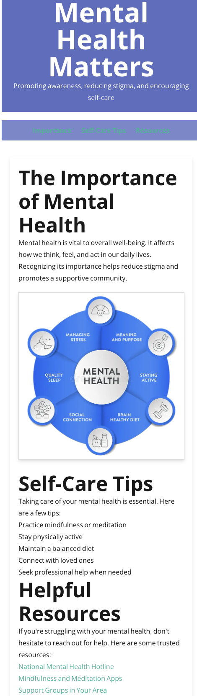</td>
</tr>
<tr>
    <td>53</td>
    <td>`button-label-mismatch`</td>
    <td>Critical</td>
    <td>Buttons labels are unclear or fail to specify their purpose.</td>
    <td>
        <pre>&lt;!DOCTYPE html&gt;  &lt;html lang=&quot;en&quot;&gt;  &lt;head&gt;      &lt;meta charset=&quot;UTF-8&quot;&gt;      &lt;meta name=&quot;viewport&quot; content=&quot;width=device-width, initial-scale=1.0&quot;&gt;      &lt;meta name=&quot;description&quot; content=&quot;A webpage promoting sustainable living with an interactive feature to display eco-friendly tips.&quot;&gt;      &lt;title&gt;Sustainable Living&lt;/title&gt;      &lt;/head&gt;  &lt;body&gt;      &lt;header&gt;          &lt;h1&gt;Sustainable Living&lt;/h1&gt;          &lt;p&gt;Small steps for a greener planet.&lt;/p&gt;      &lt;/header&gt;        &lt;div class=&quot;container&quot;&gt;          &lt;main&gt;              &lt;h2&gt;Eco-Friendly Tips&lt;/h2&gt;              &lt;p&gt;Click the button below to reveal practical tips for sustainable living:&lt;/p&gt;             &lt;! –– Accessibility Violation starts here ––&gt;       &lt;button id=&quot;revealTips&quot; role=&quot;button&quot; aria-label=&quot;Submit Form&quot;&gt;Show Tips&lt;/button&gt;                  &lt;div id=&quot;tips&quot; class=&quot;tips&quot;&gt;                  &lt;h3&gt;Eco-Friendly Tips&lt;/h3&gt;                  &lt;ul&gt;                      &lt;li&gt;Reduce, reuse, and recycle wherever possible.&lt;/li&gt;                      &lt;li&gt;Conserve water by fixing leaks and using water-efficient appliances.&lt;/li&gt;                      &lt;li&gt;Opt for energy-efficient lighting and appliances.&lt;/li&gt;                      &lt;li&gt;Support local and sustainable products.&lt;/li&gt;                      &lt;li&gt;Plant trees or grow your own garden to offset your carbon footprint.&lt;/li&gt;                  &lt;/ul&gt;              &lt;/div&gt;          &lt;/main&gt;      &lt;/div&gt;        &lt;footer&gt;          &lt;p&gt;&amp;amp;copy; 2025 Sustainable Living Initiative  &lt;a href=&quot;#&quot; style=&quot;color: #fff;&quot;&gt;Contact Us&lt;/a&gt;&lt;/p&gt;      &lt;/footer&gt;        &lt;script&gt;          const button = document.getElementById(&amp;#x27;revealTips&amp;#x27;);          const tips = document.getElementById(&amp;#x27;tips&amp;#x27;);            button.addEventListener(&amp;#x27;click&amp;#x27;, () =&gt; {              tips.style.display = tips.style.display === &amp;#x27;block&amp;#x27; ? &amp;#x27;none&amp;#x27; : &amp;#x27;block&amp;#x27;;          });      &lt;/script&gt;  &lt;/body&gt;  &lt;/html&gt;</pre>
    </td>
    <td>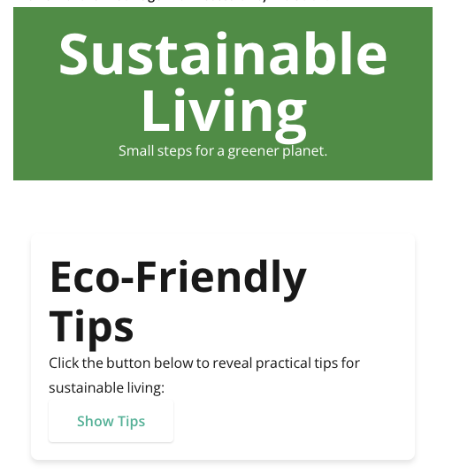</td>
</tr>
<tr>
    <td>54</td>
    <td>`button-label-mismatch`</td>
    <td>Critical</td>
    <td>Buttons labels are unclear or fail to specify their purpose.</td>
    <td>
        <pre>&lt;!DOCTYPE html&gt;  &lt;html lang=&quot;en&quot;&gt;  &lt;head&gt;      &lt;meta charset=&quot;UTF-8&quot;&gt;      &lt;meta name=&quot;viewport&quot; content=&quot;width=device-width, initial-scale=1.0&quot;&gt;      &lt;meta name=&quot;description&quot; content=&quot;A webpage promoting healthy eating habits with interactive tips on balanced diets.&quot;&gt;      &lt;title&gt;Healthy Eating Habits&lt;/title&gt;      &lt;/head&gt;  &lt;body&gt;      &lt;header&gt;          &lt;h1&gt;Healthy Eating&lt;/h1&gt;          &lt;p&gt;Simple steps to build better eating habits.&lt;/p&gt;      &lt;/header&gt;        &lt;div class=&quot;container&quot;&gt;          &lt;main&gt;              &lt;h2&gt;Healthy Eating Tips&lt;/h2&gt;              &lt;p&gt;Click the button below to learn more about maintaining a balanced diet:&lt;/p&gt;                &lt;! –– Accessibility Violation starts here ––&gt;    &lt;button id=&quot;revealTips&quot; aria-label=&quot;Click to go back to the homepage&quot; title=&quot;Click to go back to the homepage&quot;&gt;Show Tips&lt;/button&gt;                &lt;div id=&quot;tips&quot; class=&quot;tips&quot;&gt;                  &lt;h3&gt;Tips for a Balanced Diet&lt;/h3&gt;                  &lt;ul&gt;                      &lt;li&gt;Incorporate more fruits and vegetables into your meals.&lt;/li&gt;                      &lt;li&gt;Stay hydrated by drinking plenty of water.&lt;/li&gt;                      &lt;li&gt;Choose whole grains over refined grains.&lt;/li&gt;                      &lt;li&gt;Limit your intake of added sugars and saturated fats.&lt;/li&gt;                      &lt;li&gt;Practice portion control to avoid overeating.&lt;/li&gt;                  &lt;/ul&gt;              &lt;/div&gt;          &lt;/main&gt;      &lt;/div&gt;        &lt;footer&gt;          &lt;p&gt;&amp;amp;copy; 2025 Healthy Eating Initiative  &lt;a href=&quot;#&quot; style=&quot;color: #fff;&quot;&gt;Contact Us&lt;/a&gt;&lt;/p&gt;      &lt;/footer&gt;        &lt;script&gt;          const button = document.getElementById(&amp;#x27;revealTips&amp;#x27;);          const tips = document.getElementById(&amp;#x27;tips&amp;#x27;);            button.addEventListener(&amp;#x27;click&amp;#x27;, () =&gt; {              tips.style.display = tips.style.display === &amp;#x27;block&amp;#x27; ? &amp;#x27;none&amp;#x27; : &amp;#x27;block&amp;#x27;;          });      &lt;/script&gt;  &lt;/body&gt;  &lt;/html&gt;</pre>
    </td>
    <td>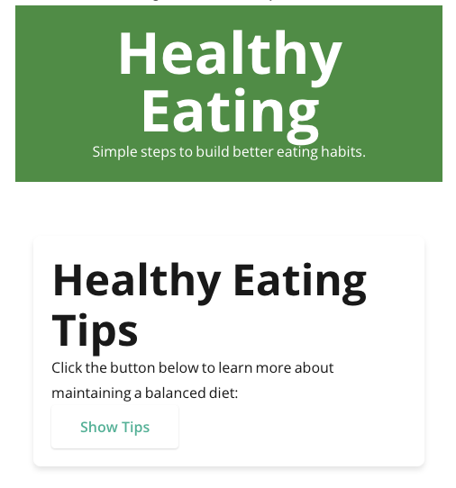</td>
</tr>
<tr>
    <td>55</td>
    <td>`button-label-mismatch`</td>
    <td>Critical</td>
    <td>Buttons labels are unclear or fail to specify their purpose.</td>
    <td>
        <pre>&lt;!DOCTYPE html&gt;  &lt;html lang=&quot;en&quot;&gt;  &lt;head&gt;      &lt;meta charset=&quot;UTF-8&quot;&gt;      &lt;meta name=&quot;viewport&quot; content=&quot;width=device-width, initial-scale=1.0&quot;&gt;      &lt;meta name=&quot;description&quot; content=&quot;A webpage promoting climate change awareness and actionable steps.&quot;&gt;      &lt;title&gt;Climate Change Action&lt;/title&gt;      &lt;/head&gt;  &lt;body&gt;      &lt;header&gt;          &lt;h1&gt;Take Action on Climate Change&lt;/h1&gt;          &lt;p&gt;Simple actions for a sustainable future.&lt;/p&gt;      &lt;/header&gt;        &lt;div class=&quot;container&quot;&gt;          &lt;main&gt;              &lt;h2&gt;Get Involved&lt;/h2&gt;              &lt;p&gt;Click the button below to submit your pledge for climate action:&lt;/p&gt;            &lt;! –– Accessibility Violation starts here ––&gt;        &lt;button id=&quot;pledgeButton&quot; role=&quot;link&quot; aria-labelledby=&quot;Upload Document&quot;&gt;Learn More&lt;/button&gt;                              &lt;div id=&quot;formContainer&quot; class=&quot;form-container&quot;&gt;                  &lt;h3&gt;Your Climate Pledge&lt;/h3&gt;                  &lt;form&gt;                      &lt;label for=&quot;name&quot;&gt;Your Name:&lt;/label&gt;                      &lt;input type=&quot;text&quot; id=&quot;name&quot; name=&quot;name&quot; placeholder=&quot;Enter your name&quot;&gt;                        &lt;label for=&quot;email&quot;&gt;Your Email:&lt;/label&gt;                      &lt;input type=&quot;email&quot; id=&quot;email&quot; name=&quot;email&quot; placeholder=&quot;Enter your email&quot;&gt;                        &lt;button type=&quot;submit&quot;&gt;Submit Pledge&lt;/button&gt;                  &lt;/form&gt;              &lt;/div&gt;          &lt;/main&gt;      &lt;/div&gt;        &lt;footer&gt;          &lt;p&gt;&amp;amp;copy; 2025 Climate Change Initiative  &lt;a href=&quot;#&quot; style=&quot;color: #fff;&quot;&gt;Contact Us&lt;/a&gt;&lt;/p&gt;      &lt;/footer&gt;        &lt;script&gt;          const button = document.getElementById(&amp;#x27;pledgeButton&amp;#x27;);          const formContainer = document.getElementById(&amp;#x27;formContainer&amp;#x27;);            button.addEventListener(&amp;#x27;click&amp;#x27;, () =&gt; {              formContainer.style.display = formContainer.style.display === &amp;#x27;block&amp;#x27; ? &amp;#x27;none&amp;#x27; : &amp;#x27;block&amp;#x27;;          });      &lt;/script&gt;  &lt;/body&gt;  &lt;/html&gt;&lt;/p&gt;</pre>
    </td>
    <td>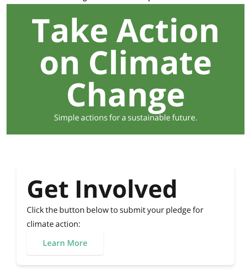</td>
</tr>
</table>
